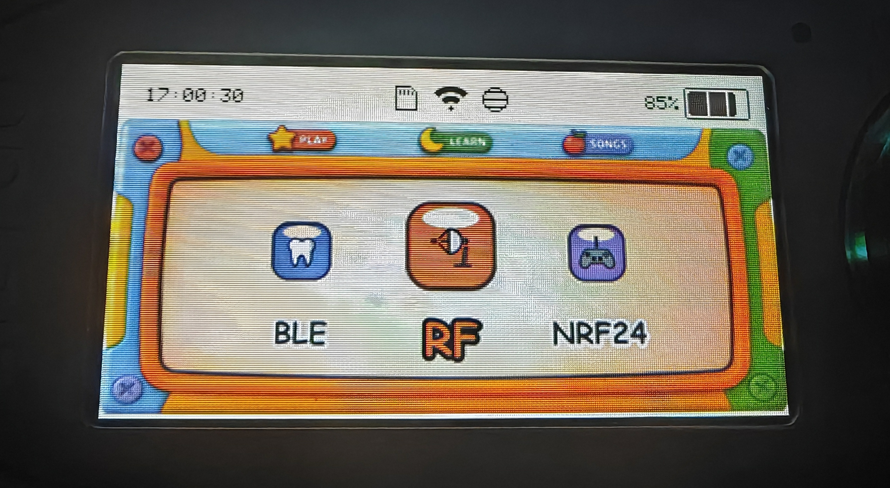
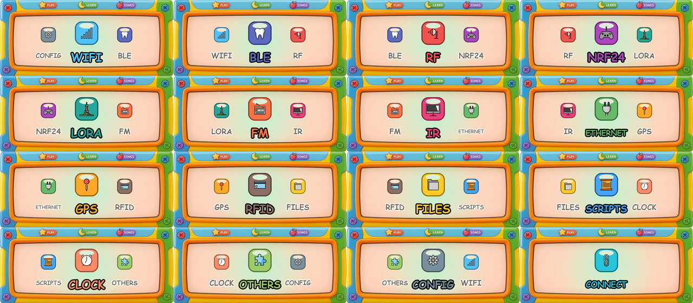
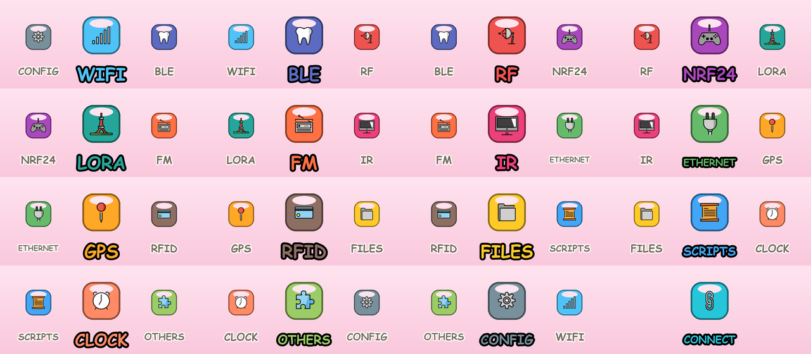
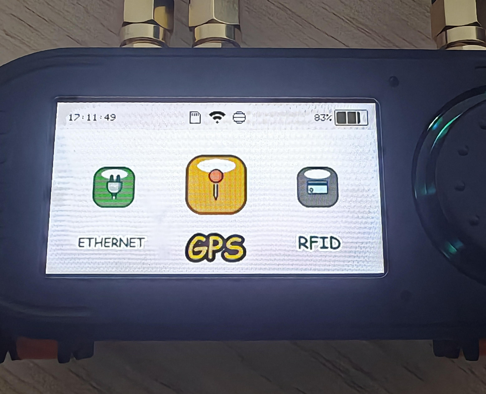

# 🧸 Baby Toy — Bruce Theme

🇺🇸 <a href="README.md">English</a> · 🇫🇷 <b>Français</b>

  

Un thème UI **jouet enfant** coloré et fun pour le firmware **[Bruce](https://github.com/BruceDevices/firmware)** sur LilyGO T-Embed CC1101 (320×170). Chaque menu est un **carrousel horizontal** — précédent · **courant** · suivant — avec un picto cartoon coloré sur une pastille candy et un gros libellé. Le libellé courant reprend la couleur de son picto, contour noir. Deux variantes incluses.

| 🖥️ Sur l'appareil |
|:---:|
|  |

## 🎨 Deux variantes

| | Aperçu |
|---|---|
| **`Baby_Toy`** — cadre tablette jouet complet (bandeau PLAY/LEARN/SONGS) |  |
| **`Baby_Toy2`** — sans cadre, fond rose, **pictos plus gros** |  |

## ✨ Détails

- 🎠 Carrousel horizontal (préc. petit · **courant grand/vif** · suiv. petit), texte **intégré dans l'image** (`label: 0`).
- 🍬 Pictos **OpenMoji** cartoon sur pastilles candy colorées (une couleur par catégorie), reflet glossy.
- 🔠 Libellé courant en **couleur du picto + contour noir** (Comic Sans), voisins atténués.
- 🔢 Voisins peints selon l'**ordre réel** du menu Bruce T-Embed CC1101 (FM inclus).

## 📦 Contenu

Chaque variante contient **4 tailles** × **16 PNG** + son `.json` :

| Dossier | Image | Écran cible |
|---|---|---|
| `105px/` | 240×105 | M5StickC Plus (240×135) |
| `140px/` | 320×140 | **T-Embed CC1101 / Cardputer (320×170)** |
| `180px/` | 320×180 | écrans ~320×210 |
| `192px/` | 320×192 | écrans ~320×222 |

> ℹ️ **Barre d'état** — Bruce réserve **30 px en haut** (heure / SD / WiFi / batterie). La bonne taille = **hauteur écran − 30**. Pour le **T-Embed CC1101 → `140px`**.

## 🚀 Installation

1. Copie **`Baby_Toy`** et/ou **`Baby_Toy2`** à la racine de la carte SD.
2. Sur l'appareil : **Config → UI Theme → `Baby_Toy/140px/Theme_Baby_Toy.json`** (ou `Baby_Toy2/140px/Theme_Baby_Toy2.json`).
3. Via WiFi : **Files → WebUI**, upload le dossier, puis sélectionne le `.json`.

## 🛒 Matériel

*Liens partenaires Amazon : si vous achetez via ces liens, le projet touche une petite commission, sans surcoût pour vous.*

<table>
<tr>
<td align="center" width="33%">
   
  <b><a href="https://www.amazon.fr/dp/B0D45MSMJR?linkCode=ll2&amp;tag=koua29bbabytheme-21&amp;ref_=as_li_ss_tl">Batterie Anker 545 (10 000 mAh)</a></b> Pour faire tourner le T-Embed loin d'une prise
</td>
<td align="center" width="33%">
   
  <b><a href="https://www.amazon.fr/dp/B0C1FCZM94?linkCode=ll2&amp;tag=koua29bbabytheme-21&amp;ref_=as_li_ss_tl">Antenne SMA 433 MHz (lot de 2)</a></b> Antenne sub-GHz pour la radio CC1101
</td>
<td align="center" width="33%">
   
  <b><a href="https://www.amazon.fr/dp/B0B7NVMBPL?linkCode=ll2&amp;tag=koua29bbabytheme-21&amp;ref_=as_li_ss_tl">microSD SanDisk 64 Go (lot de 2)</a></b> Pour les thèmes, scripts et captures Bruce
</td>
</tr>
</table>

En tant que Partenaire Amazon, je réalise un bénéfice sur les achats remplissant les conditions requises.

## 🎨 Crédits

- Thème & fond par **koua29**.
- Pictos : **[OpenMoji](https://openmoji.org)** — licence **CC BY-SA 4.0** (les pictos et images de menu qui les incorporent restent sous CC BY-SA 4.0).
- Police : **Comic Sans MS**. Tourne sur l'excellent **[Bruce firmware](https://github.com/BruceDevices/firmware)**.

## ☕ Un café ?

## 📄 Licence

Code & fond du dépôt sous **MIT** (voir [LICENSE](LICENSE)). Pictos OpenMoji sous **CC BY-SA 4.0**.
