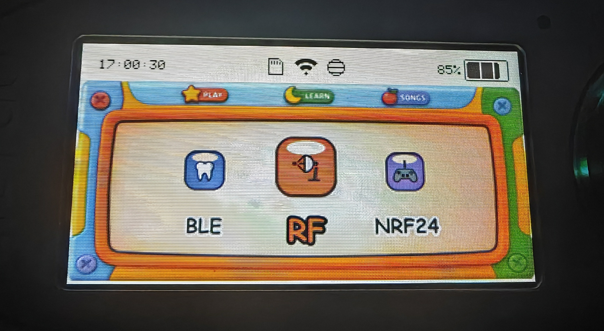
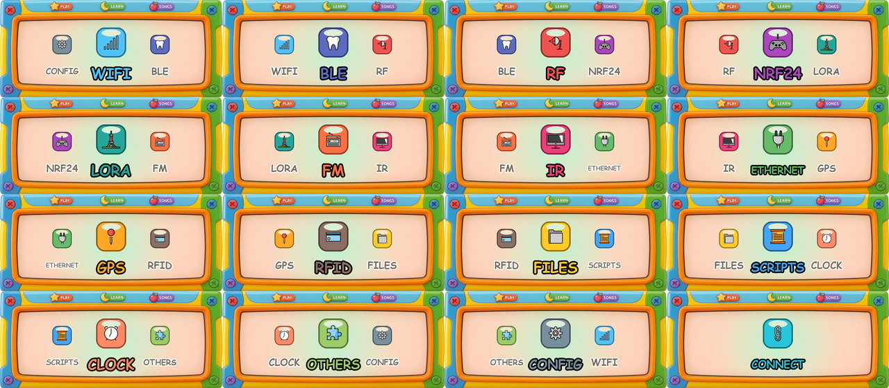
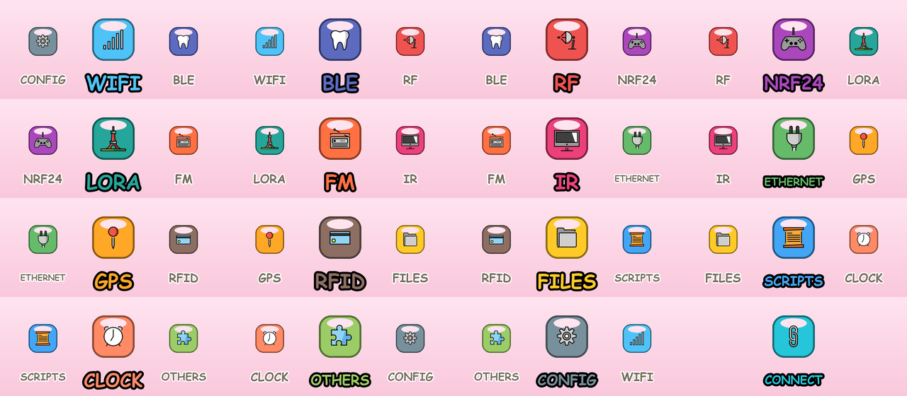
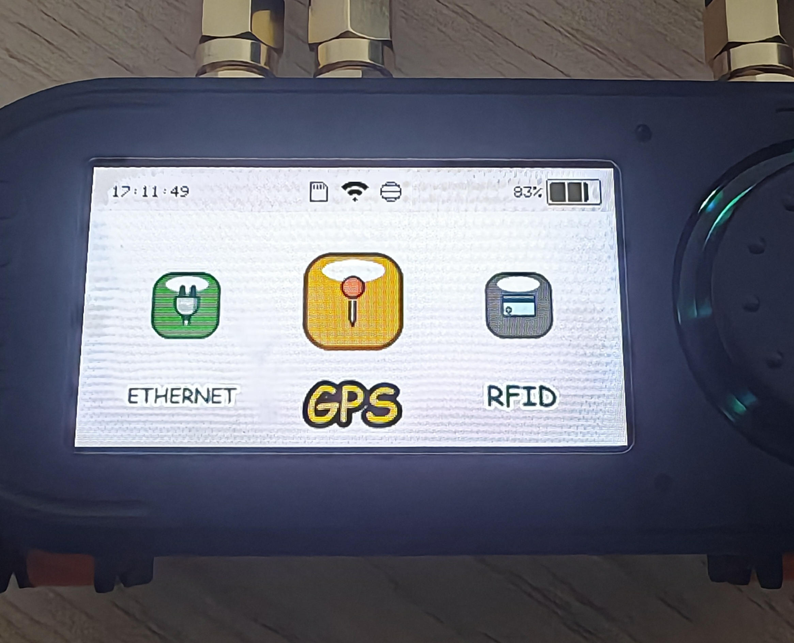

# 🧸 Baby Toy — Bruce Theme

🇺🇸 <b>English</b> · 🇫🇷 <a href="README.fr.md">Français</a>

  

A bright, playful **kids-toy** UI theme for the **[Bruce firmware](https://github.com/BruceDevices/firmware)** on the LilyGO T-Embed CC1101 (320×170). Each menu is a **horizontal carousel** — previous · **current** · next — with a colorful cartoon picto on a candy badge and a chunky label. The current label takes its own picto's color with a bold black outline. Two variants included.

| 🖥️ On the device |
|:---:|
|  |

## 🎨 Two variants

| | Preview |
|---|---|
| **`Baby_Toy`** — full toy-tablet frame (PLAY/LEARN/SONGS banner) |  |
| **`Baby_Toy2`** — frameless, pink background, **bigger pictos** |  |

## ✨ Details

- 🎠 Horizontal carousel (small previous · **large, vivid current** · small next), text **baked into the image** (`label: 0`).
- 🍬 Cartoon **OpenMoji** pictos on colorful candy badges (one color per category), with a glossy highlight.
- 🔠 Current label in the **picto's color with a black outline** (Comic Sans), neighbours dimmed.
- 🔢 Neighbours drawn in the **real order** of the Bruce T-Embed CC1101 menu (FM included).

## 📦 Contents

Each variant contains **4 sizes** × **16 PNGs** + its `.json`:

| Folder | Image | Target screen |
|---|---|---|
| `105px/` | 240×105 | M5StickC Plus (240×135) |
| `140px/` | 320×140 | **T-Embed CC1101 / Cardputer (320×170)** |
| `180px/` | 320×180 | ~320×210 screens |
| `192px/` | 320×192 | ~320×222 screens |

> ℹ️ **Status bar** — Bruce reserves **30 px at the top** (time / SD / WiFi / battery). The right size = **screen height − 30**. For the **T-Embed CC1101 → `140px`**.

## 🚀 Installation

1. Copy **`Baby_Toy`** and/or **`Baby_Toy2`** to the root of the SD card.
2. On the device: **Config → UI Theme → `Baby_Toy/140px/Theme_Baby_Toy.json`** (or `Baby_Toy2/140px/Theme_Baby_Toy2.json`).
3. Over WiFi: **Files → WebUI**, upload the folder, then select the `.json`.

## 🛒 Hardware

*Amazon affiliate links: if you buy through these links, the project earns a small commission at no extra cost to you.*

<table>
<tr>
<td align="center" width="33%">
   
  <b><a href="https://www.amazon.com/dp/B0D45MSMJR?linkCode=ll2&amp;tag=koua29bbabytheme-20&amp;ref_=as_li_ss_tl">Anker 545 power bank (10,000 mAh)</a></b> Keeps the T-Embed running away from an outlet
</td>
<td align="center" width="33%">
   
  <b><a href="https://www.amazon.com/dp/B0C1FCZM94?linkCode=ll2&amp;tag=koua29bbabytheme-20&amp;ref_=as_li_ss_tl">433 MHz SMA antenna (2-pack)</a></b> Sub-GHz antenna for the CC1101 radio
</td>
<td align="center" width="33%">
   
  <b><a href="https://www.amazon.com/dp/B0B7NVMBPL?linkCode=ll2&amp;tag=koua29bbabytheme-20&amp;ref_=as_li_ss_tl">SanDisk 64 GB microSD (2-pack)</a></b> For Bruce themes, scripts and captures
</td>
</tr>
</table>

As an Amazon Associate I earn from qualifying purchases.

## 🎨 Credits

- Theme & background by **koua29**.
- Pictos: **[OpenMoji](https://openmoji.org)** — **CC BY-SA 4.0** license (the pictos and the menu images that include them stay under CC BY-SA 4.0).
- Font: **Comic Sans MS**. Runs on the excellent **[Bruce firmware](https://github.com/BruceDevices/firmware)**.

## ☕ Buy me a coffee

## 📄 License

Repository code & background under **MIT** (see [LICENSE](LICENSE)). OpenMoji pictos under **CC BY-SA 4.0**.
